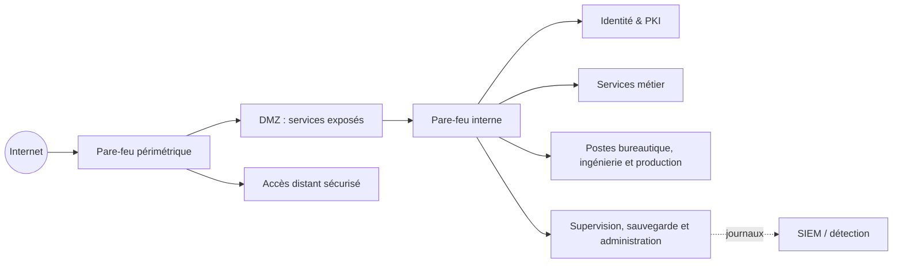

# PA8 — AgroMeca | Architecture & cybersécurité

> Étude de cas d'infrastructure sécurisée réalisée sur **4 mois** par une équipe de **8 personnes**.

Ce dépôt présente le travail de conception, de sécurisation et de gouvernance livré pour le projet AgroMeca. Il ne publie volontairement **ni configuration, ni adresse réseau, ni nom d'hôte, ni règle de pare-feu, ni document interne complet**.

## Le projet en bref

| Élément | Portée |
| --- | --- |
| Contexte | Système d'information d'une entreprise industrielle : données clients, plans CAO, production et services collaboratifs |
| Durée | 4 mois |
| Équipe | 8 membres |
| Analyse de risques | 31 scénarios étudiés et réévalués après mesures de sécurité |
| Infrastructure | 30+ machines virtuelles et services métier, sécurité et exploitation |
| Approche | Défense en profondeur, segmentation, identité centralisée, supervision et continuité d'activité |

## Architecture de sécurité — vue publique simplifiée

Cette représentation est intentionnellement abstraite : la documentation publique ne contient pas de plan d'adressage, de flux détaillés, de règles, de certificats ou de secrets.

## Résultats livrés

- Dossier d'Architecture Technique (DAT) : architecture, zones de sécurité, services, procédures d'exploitation, continuité et matrice de flux.
- Architecture réseau segmentée : pare-feu périmétrique et interne, séparation des usages, DMZ et filtrage inter-zones selon le moindre privilège.
- Identité et chiffrement : Active Directory, LDAP/LDAPS, GPO, PKI hiérarchisée et certificats de services.
- Services d'infrastructure : DNS, reverse proxy, proxy sortant, messagerie, stockage collaboratif, ERP, inventaire et gestion de parc.
- Supervision et résilience : centralisation des journaux, IDS/HIDS, alertes, sauvegardes et procédures de restauration.
- Analyse de risques : besoins de confidentialité, intégrité et disponibilité ; scénarios de menace ; prévention, protection, récupération et détection.
- Gouvernance : RACI, inventaire des composants et organisation des responsabilités.

## Ma contribution — Sidi Oumar GANO

La matrice RACI et l'historique de livrables attribuent à Sidi une responsabilité centrale sur la conception et l'architecture de sécurité :

- rédaction complète du **Dossier d'Architecture Technique** ;
- responsabilité / co-responsabilité des pare-feu périmétrique et interne ;
- responsabilité d'architecture DNS et domaine ;
- responsabilité du reverse proxy et du proxy sortant ;
- contribution au schéma d'architecture global ;
- contribution à l'analyse de risques en soutien de la responsable principale.

Les périmètres exacts et l'attribution RACI sont détaillés dans [mes contributions](docs/contributions.md). Les profils GitHub de l'équipe seront ajoutés après validation de chaque membre.

## Ma contribution — Ezekiel BOUNDA DJIKUI

La matrice RACI et l'inventaire des machines virtuelles attribuent à Ezekiel une responsabilité principale dans le déploiement et l'intégration des services applicatifs et des bases de données au sein de l'infrastructure AgroMeca :

- responsabilité du déploiement et de la configuration de Nextcloud, plateforme de stockage et de collaboration ;
- responsabilité de la mise en place de Dolibarr (ERP/CRM), solution de gestion des activités de l'entreprise ;
- responsabilité du déploiement de l'extranet sous Fedora, destiné à l'hébergement des services web de l'entreprise ;
- responsabilité de l'installation et de la configuration des serveurs MariaDB, notamment pour les besoins de l'extranet ;
- contribution à l'intégration des services applicatifs dans l'architecture réseau sécurisée ;
- participation aux échanges techniques concernant la segmentation VLAN, la gestion des accès, les certificats SSL et la supervision ;
- co-rédaction du rapport d'éco-conception, portant sur l'optimisation et la réduction de l'impact environnemental de l'infrastructure informatique.

## Contribution de Yann — Messagerie et SMTP

Yann ([@yann401](https://github.com/yann401)) a pris en charge l'ensemble du périmètre de messagerie du projet PA8 — AgroMeca. Son travail couvre la mise en place des services de courrier électronique, la configuration SMTP et leur intégration dans l'infrastructure du projet :

- déploiement et configuration des services de messagerie ;
- paramétrage du SMTP pour l'envoi et l'acheminement des courriels ;
- intégration de la messagerie dans l'architecture globale, en coordination avec les autres membres de l'équipe ;
- participation au schéma d'architecture et contribution à l'analyse de risques.

Cette prise en charge apporte le socle de communication par courrier électronique de l'environnement AgroMeca. Le détail de son périmètre figure dans la [documentation des contributions](docs/contributions.md#contribution-de-yann).

## Risques traités

L'analyse de risques couvre notamment :

- compromission de comptes, phishing et accès distant non autorisé ;
- ransomware et indisponibilité des sauvegardes ;
- fuite de données clients et de propriété intellectuelle ;
- altération de plans CAO ou de données de production ;
- exposition des services web et extranet ;
- mouvements latéraux et défaut de segmentation ;
- défaillances de journalisation, supervision et réponse aux incidents.

→ [Lire la synthèse de l'analyse de risques](docs/risk-management.md)

## Compétences mises en œuvre

`Architecture réseau` · `Segmentation` · `Pare-feu` · `DMZ` · `DNS` · `Reverse proxy` · `Proxy sortant` · `Active Directory` · `PKI` · `LDAP/LDAPS` · `VPN` · `SIEM` · `IDS/HIDS` · `Gestion des risques` · `RACI` · `PRA / sauvegarde`

## Documentation

- [Vue d'architecture et principes de sécurité](docs/architecture-overview.md)
- [Synthèse de l'analyse de risques](docs/risk-management.md)
- [Contributions et matrice RACI](docs/contributions.md)
- [Équipe et profils GitHub](TEAM.md)
- [Règles de publication et gestion des informations sensibles](SECURITY.md)
- [Captures et schémas publics à ajouter](assets/README.md)

---

*Projet académique réalisé en équipe. Ce dépôt présente les livrables et contributions dans un format public et non exploitable.*
